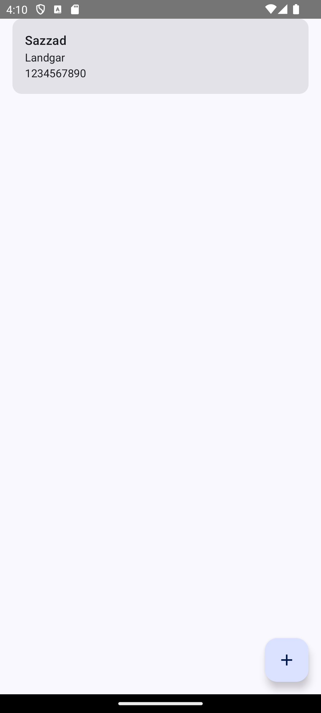
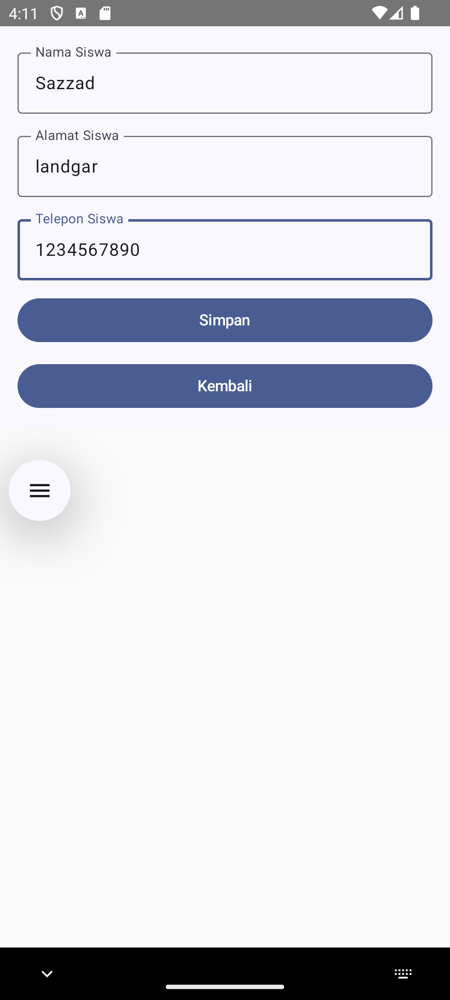

# RoomDatabase

An Android student-management app built with Kotlin, Jetpack Compose, and Room. The app stores student records locally and provides a simple Indonesian-language interface for viewing and adding students.

## Features

- Displays saved students with name, address, and phone number.
- Adds a student through a validated entry form.
- Persists data locally with Room.
- Uses Compose Navigation to switch between the list and entry screens.

## Screens

### Student list

The home screen shows saved student information in a card. Tap the **+** button to open the entry form.



### Student entry

The entry screen collects the student's name, address, and phone number. **Simpan** saves the record, while **Kembali** returns to the list.



## Technology

- Kotlin
- Jetpack Compose and Material 3
- Room Database
- Navigation Compose
- Android Gradle Plugin and KSP

## Build

Open the project in Android Studio, or run:

```shell
./gradlew assembleDebug
```

On Windows, use `gradlew.bat assembleDebug`.
